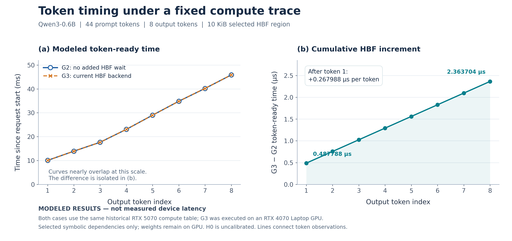

# 逐 token 模拟时间与 HBF 增量



## 如何读图

- **左图 (a)**：从请求计时起点到每个输出 token 就绪的模拟时间，单位 **ms**。
  G2 是固定计算表的零额外 HBF 等待重放，G3 是使用同一表、由当前 HBF 后端提供依赖等待的真实 CUDA 联合执行。
  两条曲线在此尺度上几乎重合，图中没有人为错开数据；圆圈和叉号用于区分。
- **右图 (b)**：对应 token 的 `G3 - G2`，即从请求开始累计增加的 HBF 模拟等待，单位 **µs**。
  它不是“该 token 单步等待”。第一个 token 的增量为 0.487788 µs，之后每一步增加 0.267988 µs，
  第八个 token 累计为 2.363704 µs。
- 两个纵轴均从 **0** 开始，无断轴；线段仅连接离散输出观测点，不表示连续时间测量。
- 不画误差条：这不是独立硬件采样的统计均值；完整记录版与两次 timing 版使用同一固定表，模拟结果一致。
- 六位小数表示精确整数模拟时间的单位换算，**不代表真实硬件测量具备相同精度**。

## 图注（论文初稿可用）

**图：固定计算轨迹下的逐 token 模拟就绪时间与 HBF 等待增量。**
(a) G2 零额外等待重放与 G3 真实 CUDA/当前后端联合执行的模拟 token 就绪时间。
(b) 对应输出时刻之差，即累积 HBF 模拟等待。两组使用相同的历史 RTX 5070 冻结计算表，
G3 在 RTX 4070 Laptop GPU 上实际执行。实验为 Qwen3-0.6B、44-token 输入、8 个非 EOS 输出，
仅覆盖 10 KiB 选定符号权重依赖；权重仍驻 GPU，KV 为原生实现，H0 未硬件校准。
结果用于验证固定轨迹下的接入与计时机制，不是本机实测延迟或全模型 HBF 卸载性能预测。

## 文件与证据

- [PNG 预览](token-timing.png)、[PDF 矢量版](token-timing.pdf)、[SVG 可编辑版](token-timing.svg)。
- [逐 token CSV](token-timing.csv)：同时保留原始整数 ps、ms/µs 精确换算和守恒残差。
- [绘图脚本](plot.py)、[绘图依赖](requirements.txt)、[绘图核验结果](figure-check.json)。
- [精简证据来源清单](evidence-manifest.json)：所有证据均从原始运行逐字节复制，记录原路径、字节数、SHA-256。
- [配对审计](evidence/paired-audit.json)、[正式结果](evidence/result.json)、[运行条件](evidence/conditions.json)。
- [初始化故障验收](evidence/initialization-program-fail-audit.json)、[消费者限额验收](evidence/consumer-time-limit-audit.json)。
  正常 G3 排空；限额负例按设计保留一个未决 Global，**没有排空**。不能把顶层正例状态泛化到负例。
- [全部原始运行产物的本地哈希核验摘要](evidence/final-artifact-verification.json)。

这里的精简证据足够重画本图，但不替代数值快照、活动日志、固定表等完整原始运行数据。
完整产物索引的 SHA-256 在来源清单内；本地原始数据目录不随 Git 分发。
更多实验设置及结果见 [验收报告](../../gpu_s_integration.md)。

## 复现

从仓库根目录，在 Python >=3.11 环境中执行：

```bash
python -m pip install -r docs/figures/gpu-s-20261104/requirements.txt
python docs/figures/gpu-s-20261104/plot.py --output build-gpu-s-figure
```

不需要 GPU、模型或原始大包。脚本先验证精简证据的哈希和整数时序守恒、G2/G3指标、
full/timing一致性，再输出 PNG/PDF/SVG/CSV/核验记录。
不带 `--output` 时重新生成本目录的图和 CSV；不会改写 `evidence` 子目录。
图表使用英文标签便于论文排版，正文释义见本页。
