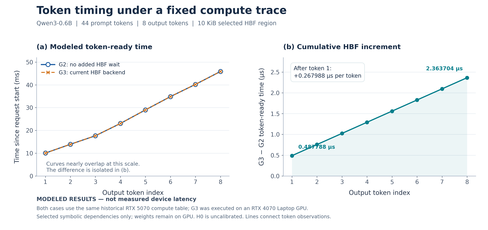

# 真实 GPU S 实验与新后端集成验收（2026-11-04）

## 结论

**已在本机 RTX 4070 Laptop GPU 上跑通真实 CUDA + 当前 EventLab 后端的 8 步最小联合实验。**
原始数据不是只有报告：上游新包已完整恢复并独立验证，模型也从官方固定版本恢复为同一 GGUF 字节身份。
正常 G3、原生 CUDA/独立 CPU 数值、同表计时守恒、两次 timing 对照和两个依赖失败负例均通过。

这是**固定轨迹机制验收**：计算时长仍来自上游 RTX 5070 的既有冻结表，
不是本机 RTX 4070 重新采样的计算时间，更不是已校准的 HBF 硬件 TTFT/TPOT 预测。

机器可读证据：[本次验收记录](validation/gpu-s-integration-20261104.json)。
随源码发布的逐字节精简副本：[最终结果](figures/gpu-s-20261104/evidence/result.json)、
[运行条件](figures/gpu-s-20261104/evidence/conditions.json)、
[逐token配对审计](figures/gpu-s-20261104/evidence/paired-audit.json)、
[来源及哈希清单](figures/gpu-s-20261104/evidence-manifest.json)。
[完整本地产物索引](../build-real-gpu-s-run-20261104-001/artifact-index.json)及大体量快照被忽略，
不随源码 Git 分发；本页其余 `build-*` 链接仅在保留本次原始产物的机器上可用。

## 原始包和输入

上游：[minexp 固定提交 d6cb501](https://github.com/ZeePgm/RealGPUAcess_v0/tree/d6cb5016aed9ec72f3bc36f4be114bcd6cb8bdcb)。

- 102 个分片，压缩归档 212,313,367 B；恢复 **22,379 个文件、4,434,867,749 B**，全部 SHA-256 匹配。
- 独立重审 S6 reference、S8 native、S8 G3-full：各 **1,369 个数值比较项全部通过**，各 448 个有效 KV 发布数组通过。
- 新 G2 重放完整 18,072 表段，token/事件与历史逐项一致，指标一致。
- 上游曾缺失的 10,825 个数值快照由组员重新生成并与旧索引全文件哈希匹配，恢复过程随包保留。
- GGUF 本体不在包中。从官方 `Qwen/Qwen3-0.6B` revision
  `c1899de289a04d12100db370d81485cdf75e47ca` 下载，经相同转换源码生成 F16 GGUF，
  **全文件 SHA-256 精确匹配**：`74878aba1d10648eae3d6cfef822f8c59ce3217b3808b35fce2dd02d975952a2`。
- 原历史转换记录未找到；新恢复记录明确标注为新生成，不冒充原记录。
  [恢复说明](../build-real-gpu-model-input/MODEL-RECOVERY.md)、
  [恢复转换身份](../build-real-gpu-model-input/conversion.json)。

历史重审与新后端验收分开保存；[历史重审结果](../build-minexp-audit-20261104/result.json)
明确 `new_GPU_or_backend_executed=false`。

## 本次实际执行结果

环境：Windows、MSVC 19.43、CUDA Toolkit 12.9.86、CUPTI 12.9.79、cuBLAS 12.9.1.4、
RTX 4070 Laptop 8 GB、驱动 596.21；独立 CPU 参照为 Python 3.12.14、NumPy 2.2.6、Torch 2.11.0+cpu。
完整流程墙钟约 311.32 秒，包括构建身份复核、模型加载、数值/因果审计和负例，**不进入模拟指标**。

| 检查 | 本次结果 |
|---|---|
| 真实原生 CUDA | 44-token prompt，8 个非 EOS 输出，51 个有效位置；无多算一个预测步 |
| 原生 CUDA / 独立 CPU | 1,369/1,369 数值比较项通过，448/448 有效 KV 发布数组通过 |
| G3 / 独立 CPU | 1,369/1,369 数值比较项通过，448/448 有效 KV 发布数组通过 |
| 原生 CUDA / G3 | token、完整 logits、3,608 份有效快照及语义事件逐位/逐项一致 |
| 真实门控 | 每次成功完成所选 HBF 依赖后才发射消费者，原始 CUPTI/API 因果审计通过 |
| 分段覆盖 | 18,072 个生产窗口完整消费，其中 5,880 个有实际活动；3,608 个核验复制窗口不计模拟时长 |
| 正常排空 | G3-full 与两次 timing 均关闭输入、Host/Device 排空且 workload_success=true |
| 模拟确定性 | full + 两次 timing 的 logits、token 时刻、桥接/统计/会话模拟状态一致 |
| 计时守恒 | 8 个输出的整数残差全部为 0 |
| 初始化 program-fail | 预期退出码 87；0 GPU node、0 token，正常失败排空；未误报成功 |
| 消费者时间限额 | 预期退出码 88；依赖消费者未发射、0 token；**保留 1 个未决 Global，Host/Device 未排空** |
| 新增 CPU 合同回归 | 38/38，通过可变输出/EOS夹具、SDK选择和身份篡改拒绝等检查 |
| 既有前端 Python 合同 | 环境 9/9、验证器 5/5、身份 25/25 通过 |

负例“通过”表示预期失败行为正确，不能将限额保留状态写成正常完成/排空。
本次实际 GPU 输出不含 EOS；EOS 只做了 CPU 夹具回归。

最终独立核对了 **7,536 个新产物、1,438,423,007 B**，全部哈希匹配；运行前后构建 seal 不变。
[最终完整性核验](../build-real-gpu-s-evidence/final-artifact-verification.json)。

## 模拟指标（非本机实测 token 延迟）

左图为各输出的累计模拟就绪时间（ms），右图为对应 `G3−G2` 累计等待（µs）。
两条主曲线在毫秒尺度上几乎重合，没有人为偏移数据；两个纵轴均从零开始。
图中精确小数是整数模拟时间的单位换算，不代表硬件测量精度。
[图注、复现与数据](figures/gpu-s-20261104/README.md) ·
[PDF矢量版](figures/gpu-s-20261104/token-timing.pdf) ·
[逐token CSV](figures/gpu-s-20261104/token-timing.csv)。

| 指标 | G2 零等待 | G3 新后端 | G3−G2 |
|---|---:|---:|---:|
| TTFT | 10.040304 ms | 10.040791788 ms | 0.487788 µs |
| 平均 TPOT | 5.118493 ms | 5.118760988 ms | 0.267988 µs |
| 第8个输出相对时刻 | 45.869755 ms | 45.872118704 ms | 2.363704 µs |

计算总量 45,869,755,000 ps；模拟 HBF 等待 2,363,704 ps。
与历史结果相同是**同输入/同模拟语义保持**的证据，不是新后端使真实硬件变快的证据。

覆盖仅为 M2 的 **10 KiB 有效符号权重范围**（norm 4 KiB + down 6 KiB），
注册 12 KiB 包含 2 KiB padding；8 步累计读取 80 KiB，24 个读 Global，1,280 个 64B 逻辑片段。
模型完整权重仍驻 GPU，KV 使用原生实现，未模拟全权重卸载、HBM容量压力或真实数据迁移。
H0 未硬件校准，短段测量精度限制继承自原 S6 资格记录。

## 集成改动与复现

[实验说明和命令](../integrations/real_gpu/experiments/gpu_s/README.md)；
[显式路径主入口](../integrations/real_gpu/experiments/gpu_s/integrated.py)。

1. 只导入 S 实验层及来源哈希，不恢复旧 vendored 后端；独立 CMake 直接构建当前后端。
2. 显式指定基础构建、原始记录、模型和新输出目录；历史分阶段脚本保留，不拿它们硬编码的旧批次当本次入口。
3. 增加独立实验 seal，覆盖实验源码、二进制、后端、真实依赖库、CUDA/CUPTI/cuBLAS SDK；要求基础/实验运行库选择一致。
4. 修复 CUDA12/13 的 CUPTI Kernel9/Kernel10 类型兼容；实际探测类型，不猜版本号，不改计算/采样语义。
5. 独立 cuBLAS SDK 通过准确 CMake 输入和进程局部运行路径接入，未安装系统组件或修改全局 PATH。
6. 修复 EOS/可变输出计数、完整冻结表验证和新版分类数值合同报告；不丢弃表后缀，不放宽数值阈值或活动覆盖。

本次当前后端源码身份：`1713429bfc66c2939b6695029ef4b6178c4f6912eee3188067ff1530d967bab2`。
主后端实现未修改；模拟 GPU 接入暂停且未修改；旧 Qwen 案例保留。
本次没有重跑完整后端/异步 A 前端 CUDA 套件，11月3日两个 overlap 覆盖失败仍开放。
S 验收不能替代 A 路径的独立时钟与异步重叠建模工作。
