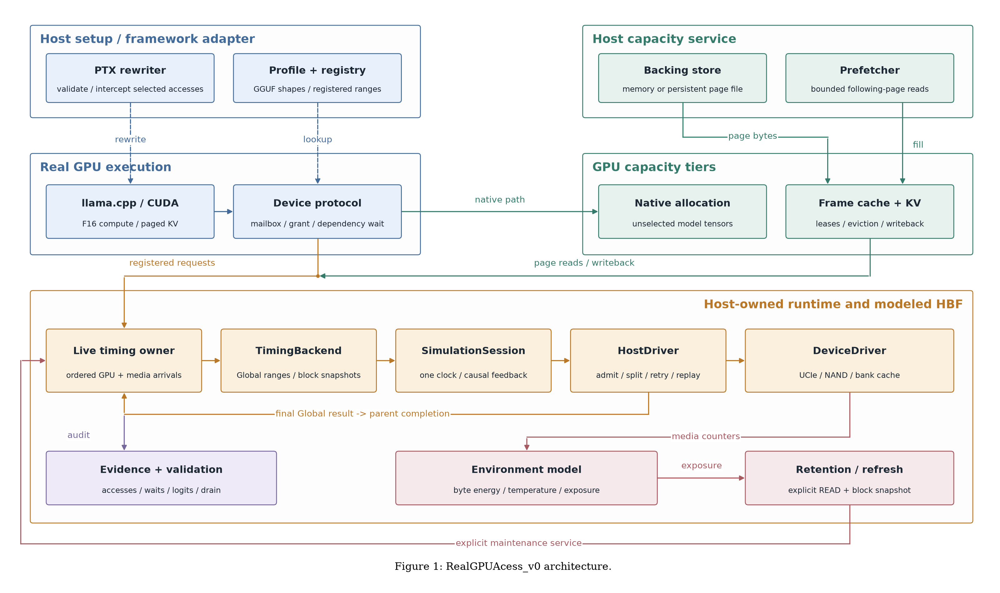

# Real GPU integration baseline

S/F fixed-activity experiments are available in [the S/F integration guide](../../docs/gpu_sf_integration.md).
Their validation is separate from the earlier asynchronous/capacity baseline below.

Imported from [ZeePgm/RealGPUAcess_v0 at 41b9f736](https://github.com/ZeePgm/RealGPUAcess_v0/tree/41b9f736164c8517c35aaafb6743a803bf656257). This branch provides real CUDA execution, selected weight interception, asynchronous requests, finite frames and all-layer paged F16 KV on the **current HBF-EventLab backend**.

**Start with the [repository integration guide](../../docs/gpu_integration.md).** It gives root-relative build commands, current validation and the independent event-model work still required. This is a functional collaboration baseline, **not a predictive modeled TTFT/TPOT release**.

**Current acceptance:** CPU suite 604/604 and Python checks 39/39 passed. The full frontend CPU/CUDA suite is **220/222 (not fully passed)** with two overlap-coverage failures under investigation. Full llama.cpp build/model inference was not completed on the integration machine because cuBLAS development components and model inputs are missing. See the guide for complete records; historical upstream results do not fill these gaps.



```text
CUDA / paged KV -> LiveTimingService -> TimingBackend
    -> SimulationSession -> HostDriver -> DeviceDriver
    -> final Global result -> parent completion -> dependent GPU work
```

## Backend and source identity

The backend is the repository root (`../..`), not a second vendored tree. The backend-only publication baseline is `8ccb1f353630f893f761b017d621812b7b9d5bf2`. Both CMake entries accept `HBFLAB_EVENTLAB_SOURCE`; the Windows wrapper accepts `-BackendSource` / `backend_source`.

[Import provenance](integration-origin.json) records the source commit, original hashes, exclusions and licensing authorization. The old backend origin/overlay, release manifest and documents under [docs/validation](docs/VALIDATION.md) are **historical upstream records**. They are not proof of fresh inference against this backend. Do not apply the old six-file overlay again.

The synchronous immutable TensorAccessBridge remains a tested reference. The asynchronous mutable path directly uses SimulationSession through the frontend producer adapter; see the [adapter contract](docs/INCREMENTAL_BACKEND.md).

## Environment and build

Use CMake >=3.24, a C++17 compiler, Python >=3.11 and a compatible CUDA toolkit/GPU. Model builds additionally require CUPTI/cuBLAS. The original validation machine used VS2022, CUDA13.0 and RTX5070 SM120a; this is historical evidence, not a portability guarantee. Explicitly select your architecture.

Commands in this README run from **this `integrations/real_gpu` directory**; commands in the repository guide run from the repository root.

```powershell
python -m venv .venv
./.venv/Scripts/python.exe -m pip install -r requirements.txt
./build.ps1 -Target cpu -Python (Resolve-Path './.venv/Scripts/python.exe').Path
ctest --test-dir ./build-cpu --output-on-failure
# Set CUDA_PATH and replace 89-real for your GPU/toolkit.
./build.ps1 -Target cuda -CudaArchitectures 89-real -EnableInjection OFF -Python (Resolve-Path './.venv/Scripts/python.exe').Path
ctest --test-dir ./build-cuda --output-on-failure
./build.ps1 -Target model -CudaArchitectures 89-real -Python (Resolve-Path './.venv/Scripts/python.exe').Path
```

The wrapper builds but does not run CTest. Model executables require separate operator/model validation; they are not registered in CTest. Model builds seal the actual backend/frontend/framework source inventory and artifacts. Use a fresh build directory after source/path changes. See [environment settings](docs/ENVIRONMENT.md).

## Model inputs and execution

Provide a supported F16 GGUF and conversion record with `gguf_sha256`, `llama_commit` and source revision. The required framework commit is `b3fa69955ea81c3b60e77e3c1e2224c4a826ffb9`; the bundled framework also includes the existing frontend overlay. Model weights are external inputs; bundled GGUF vocabulary fixtures are not inference models.

```powershell
python tools/integrated_profile.py --model ./models/model.gguf --conversion ./models/conversion.json --output ./configs/integrated/model.json
python tools/run_llama_integrated.py --profile ./configs/integrated/model.json --prompt ./adapters/llama_cpp/prompt.txt --tokens 32 --output ./output/example
```

The runner executes native-KV reference, paged bypass and online modeled modes. It checks complete logits, tokens, selected access coverage, GPU waits, KV publication, Host final outcomes, resident budgets and final close/drain. Use a fresh output directory. Profiles are rederived from GGUF metadata and hashes; editing them cannot weaken the checks. Generated local profiles/paths remain untracked.

For the full independent operator script, supply profiles named `qwen3-0.6b.json`, `qwen3-1.7b.json` and `smollm2-135m.json` in `configs/integrated`, then use `tools/check_llama_integrated.py`. The optional `tools/run_integrated_matrix.py` additionally requires a caller-supplied `--reference-matrix` with original artifacts, not only compact summaries.

## Supported scope and time interpretation

The imported model scope is dense Qwen3/llama, one sequence, F16 matrix weights/KV, selected norm/down weight ranges and all-layer paged KV. Other weights and activations remain native. Quantization, MoE, multi-sequence serving and vLLM require separate work.

The baseline uses FCFS Host/NAND, no statistics observer and memory backing. `resident_fragments=256` is a Host budget for logical 64-byte fragments, not GPU frame capacity or Device MOCS. The default four 4KiB frames are a paging-pressure configuration, not a realistic general server KV budget. KV writeback creates a whole-block snapshot; the original Host owns splitting, retries and recovery replay. Completed result/version history can grow with cumulative input.

Real bytes stay in CUDA allocations and capacity backing; HBF models symbolic behavior and timing. The original GPU/host-readiness time mapping is retained. **CPU service and diagnostic overhead can affect future simulated arrivals.** Neither `process_wall_ms` nor final backend time is a predictive token latency. An independent compute/request clock, causal dependency model and token completion events remain to be implemented.

File backing, bounded prefetch, retention/refresh and thermal APIs exist and have separate upstream checks; their simultaneous activation in all model runs is not implied. Refresh requires explicit service calls.

## Distribution and license

Clone/archive the **whole HBF-EventLab branch**, not just this subdirectory. The old standalone `package_source.py create` is disabled because it would omit the current backend; historical archive verification remains available. Do not publish local build identities, profiles, weights or raw traces as source.

Original frontend and overlay contributions are distributed under Apache-2.0 with project-maintainer authorization; existing third-party terms are retained. See [LICENSE](LICENSE), [third-party notices](THIRD_PARTY_NOTICES.md), [dependencies](docs/DEPENDENCIES.md), [architecture](docs/ARCHITECTURE.md) and [historical validation](docs/VALIDATION.md).
