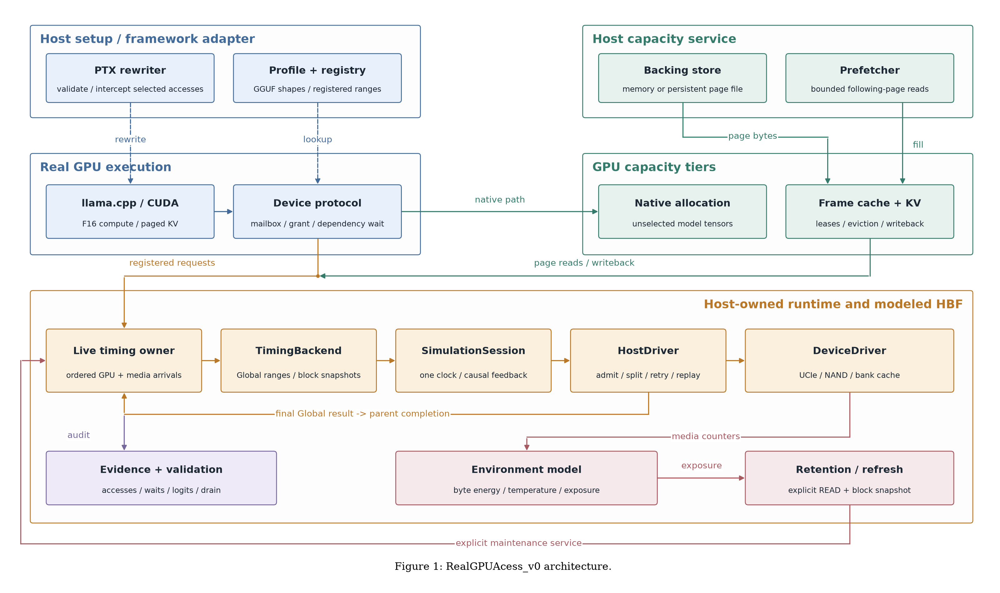

# Functional architecture

[Editable SVG](architecture.svg) and [vector PDF](architecture.pdf) accompany the
PNG. Regenerate them with ../tools/draw_architecture.py using requirements-dev.txt.

| Layer | Files / responsibilities |
|---|---|
| Setup and access selection | Profile/registry validation and PTX rewriting; ../adapters/llama_cpp/integrated_profile.*, ../src/ptx.cpp, ../src/async_module.cpp |
| Real GPU computation | Pinned llama.cpp CUDA execution, selected norm/down accesses, paged F16 attention; ../adapters/llama_cpp/integrated_weights.cu and integrated_kv.cu |
| Device protocol | Bounded mapped mailboxes, grants, stable request IDs and dependency waits; ../include/hbflab/async_device.cuh and async_protocol.hpp |
| Shared host ownership | One LiveTimingService thread serializes asynchronous GPU and capacity-media inputs; ../src/live_runtime.cpp and async_runtime.cu |
| Producer adaptation | Exact sector unions, Global grouping, logical block snapshots, parent completion and final close; ../src/backend.cpp |
| Incremental HBF | SimulationSession owns one event clock, original HostDriver and original DeviceDriver; [repository root](../../..) (no duplicate vendored backend) |
| Capacity and KV | Finite frames, page leases, eviction, writeback, sequence publication and backing files; ../src/capacity.cpp, capacity_gpu.cpp, kv.cpp and page_file.cpp |
| Maintenance and observation | Explicit prefetch/refresh, thermal exposure and retention; ../src/environment.cpp and capacity.cpp; validation under ../tests |

Dashed blue arrows denote setup transformations. Solid arrows denote implemented
interfaces: registered requests and capacity media work share one owner; final
Global results complete parents before dependent GPU work proceeds. Teal page
fills carry real backing bytes. The capacity-to-runtime connection carries modeled
media work. Real GPU and backing-store bytes are not returned by the symbolic HBF
Device model.

The upstream synchronous TensorAccessBridge is intentionally not drawn as the
shared asynchronous mutable path: the product uses SimulationSession through its
producer adapter. It remains an immutable synchronous reference tested separately.
See [the adapter contract](INCREMENTAL_BACKEND.md).

Host and NAND use FCFS in the acceptance baseline without a statistics sink.
Optional file/prefetch/environment APIs are represented because their interfaces
are implemented and independently tested; the diagram does not imply that all
options are enabled in the same model experiment. Refresh is explicitly serviced.

The architecture preserves the original real-GPU byte authority and paged-KV
implementation. It does not represent physical HBF memory, all-weight offload,
multi-stream overlap modeling, or a new TTFT/TPOT compute-record executor.
