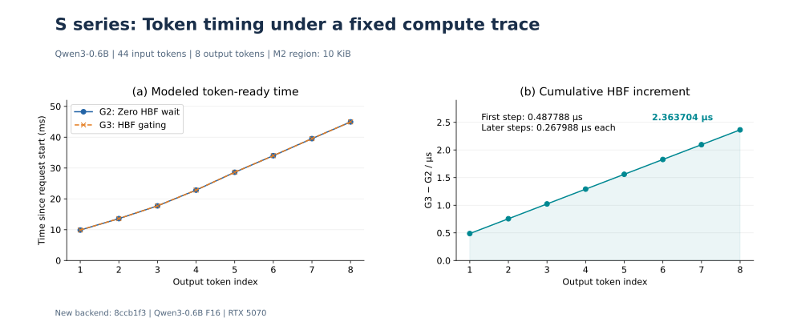
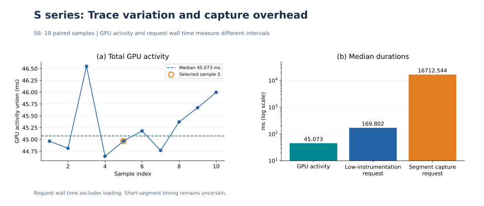
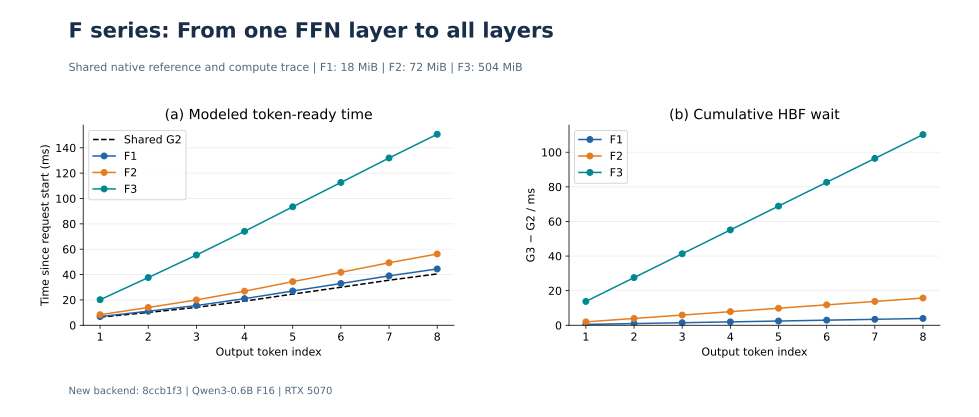
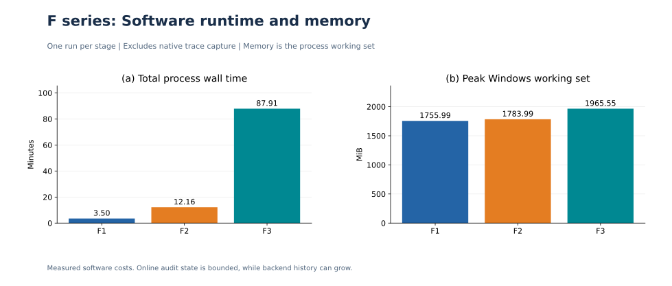
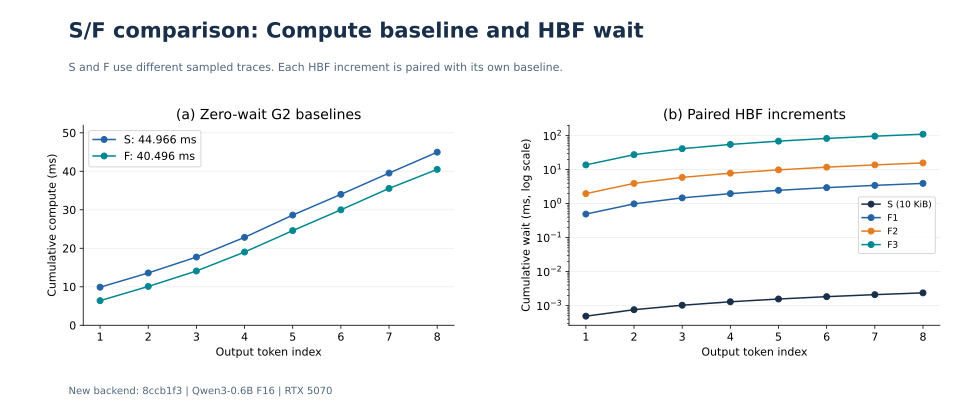
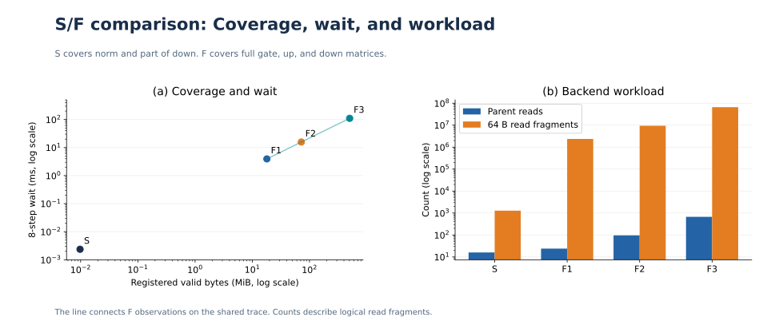
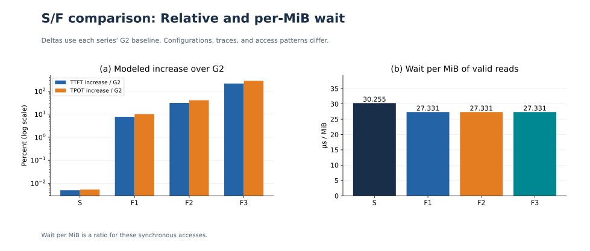

# 新后端 S 与 F 系列 GPU/HBF 联合实验报告

2026 年 11 月 5 日 · HBF-EventLab `8ccb1f353630f893f761b017d621812b7b9d5bf2`

S 系列验证小选区的数值一致性、GPU 依赖门控和时钟守恒。F 系列在同一份 F 计算表下，将完整 FFN 权重覆盖从 1 层扩到 28 层。两系列均通过各自验收，8 个 token 的配对时钟残差均为 0 ps。S 的累计 HBF 等待为 **2.363704 μs**，F1、F2、F3 分别为 **3.935599248、15.742396992、110.196778944 ms**。

## 1. 实验设置

两系列均在 RTX 5070 上运行 Qwen3-0.6B F16 GGUF，使用同一个 44-token 输入，单请求、单序列，greedy 生成 8 个 token。context/batch/ubatch 为 512/256/256，KV 保持原生 F16，每个 MUL_MAT 显式使用 F32 精度，关闭 CUDA graphs 与 flash attention。

| 条件 | S 系列主案例 S8/S9 | F 系列 F1–F3 |
|---|---|---|
| HBF 选区 | 第 10 层 norm 4096 B 和 down 的 6144 B 子区 | 完整 gate/up/down 矩阵。F1 选第 10 层，F2 选第 0、10、20、27 层，F3 选全部 28 层 |
| 有效登记量 | 10 KiB，注册范围 12 KiB，含 2 KiB 填充 | 18 / 72 / 504 MiB |
| H0 逻辑容量 | 8 MiB | 三档统一 512 MiB，F3 余 8 MiB |
| 容量几何 | 1 通道 × 1 die × 2 bank × 64 block × 16 page × 4096 B | 每 bank 4096 block，其余几何相同 |
| 活动片段预算 | 256 | 256 |
| 计算表 | S6 采集 3 对预热及 10 对正式样本，选 sample-5。18,072 个窗口，共 44.965798 ms | F1 采集一次原生轨迹，F2/F3 复用。18,072 个窗口，共 40.495695 ms |
| 联合运行和审计 | 1 次 full、2 次 timing，核验 CPU 分类数值合同、GPU 有效快照及完整 logits、片段和依赖 | 每档 1 次，核验原生 GPU 完整 logits 与 token、在线片段与父访问、CUDA 提交顺序 |
| 复用 | 已验收的 S0–S4、封存构建、模型和 M2 选区。S7/S8 共享本批 S6 新表 | 封存模型库与同一 F 可执行文件。F2/F3 校验并复用本批 F1 的 native 记录 |

真实权重保留在 GPU，HBF 保存所选区域的符号内容身份并模拟访问时序。普通写初始化在请求计时起点之前完成。G2 是按计算表做的零等待回放，G3 是在 GPU 上实际执行并等待所选 HBF 依赖完成。计算表按同步窗口统计 CUPTI kernel、memcpy 和 memset 活动区间的并集。下文分别报告模拟时钟、实测 GPU 活动和软件墙钟。TTFT 从请求计时起点计至首个 token，平均 TPOT 为首末 token 时刻差除以 7。

## 2. S 系列结果

S0–S4 建立了模型、映射、数值和门控基线。S5 复验了 2/8-token 的零计算与固定计算段，S6 采集计算表，S7 生成零等待基线，S8 运行联合对照，S9 核验结果与图表。

**图 1｜小选区的等待如何进入模拟时钟。** 左图两条曲线在毫秒尺度上几乎重合。右图以微秒显示配对差值，首 token 增加 0.487788 μs，后续每步增加 0.267988 μs，第 8 个 token 累计增加 2.363704 μs。相对同一 G2，TTFT 从 9.886771000 增至 9.887258788 ms，平均 TPOT 从 5.011289571 增至 5.011557559 ms。每个 token 的 G3 − G2 都等于此前的累计 HBF 等待。

**图 2｜固定表如何选出，以及采样的精度边界。** 左图 10 个样本的 GPU 活动总量为 44.645847–46.548366 ms，中位数 45.0733175 ms。sample-5 最接近该中位数，按预定规则入选。总量及逐 token 步的最大批间中位数漂移为 3.45%，最大批内极差/中位数为 23.37%，分别通过 10% 和 30% 门槛。右图依次给出 GPU 活动、低采集开销请求墙钟、逐段采集请求墙钟的中位数 45.073、169.802、16,712.544 ms。后两项均排除加载，计量范围包括各自的请求执行开销。短 gap/tail 的极差仍为其中位数的 23.0%–162.3%，单段精度维持 `inconclusive`，固定表通过最小轨迹验收。

S8 完成 16 次父读、24 个读 Global、1280 个 64 B 读片段，累计读取 80 KiB。原生与联合路径的完整 logits 及有效快照逐位一致，两条 GPU 路径各通过 1369 个数组的 CPU 分类数值验收。三次联合运行的模拟状态一致，均正常排空。G3 full 的软件进程墙钟为 22.404 s，两次 timing 分别为 17.642 和 17.644 s。

## 3. F 系列结果

**图 3｜同一计算轨迹下扩大完整 FFN 覆盖。** 左图的虚线是三档共享的 G2。登记量从 18 MiB 增至 72、504 MiB 时，G3 与 G2 的差值逐级扩大。右图显示每步等待分别为 0.491949906、1.967799624 和 13.774597368 ms，8 步累计等待呈 1∶4∶28。这一比例来自本次固定轨迹、512 MiB H0 和逐步同步读取的配置。

| 指标 | F1 | F2 | F3 |
|---|---:|---:|---:|
| 完整矩阵 | 3 | 12 | 84 |
| 父读次数 | 24 | 96 | 672 |
| 累计有效读取（MiB） | 144 | 576 | 4032 |
| 模拟 TTFT（ms） | 6.883839 | 8.359689 | 20.166486 |
| 模拟平均 TPOT（ms） | 5.363922 | 6.839772 | 18.646570 |
| 第 8 个 token 模拟完成时刻（ms） | 44.431294 | 56.238092 | 150.692474 |
| 累计 HBF 等待（ms） | 3.935599 | 15.742397 | 110.196779 |

**图 4｜扩大覆盖的软件成本。** 左图的联合进程墙钟分别为 3.50、12.16 和 87.91 分钟，包含模型加载、初始化、联合执行与记录。右图的峰值 working set 分别约为 1756、1784 和 1966 MiB。在线审计及时释放已完成的片段与尝试记录，三档活动峰值都为 256。总进程内存还包含模型、运行时与后端历史。墙钟和内存均为各档单次实测。

F3 完成 1,032,192 个读 Global、66,060,288 个读片段和 8,257,536 个初始化写片段，共处理 1,099,771,595 个后端事件。各档的完整 logits 和 token 与原生 GPU 路径逐位一致，逻辑访问和命令尝试错误数均为零，正常排空。离线审计每档均拒绝 5 类损坏记录。

## 4. S 与 F 对比

**图 5｜先分开计算轨迹，再比较配对等待。** S 与 F 的 G2 首 token 时刻分别为 9.886771 和 6.391889 ms，最后 token 时刻分别为 44.965798 和 40.495695 ms。首 token 相差约 3.495 ms，末 token 相差约 4.470 ms，说明轨迹的总量和逐步分布均不同。右图统一用毫秒对数轴，展示各系列内部 G3 − G2 得到的等待。跨系列的 G3 绝对差同时包含计算轨迹和等待两部分。

**图 6｜登记量扩大后，父读和片段数如何变化。** 从 S 到 F3，有效登记由 10 KiB 增至 504 MiB，累计读取由 80 KiB 增至 4032 MiB。父读次数从 16 增至 672，约为 42 倍。64 B 读片段数从 1280 增至约 6606 万，约为 51,610 倍，因为 F 的单次父读覆盖完整矩阵。左图只连接共享同一轨迹的 F 点。S 包含 norm 与 down 子区，F 使用完整 FFN 矩阵，两者在选区构成、地址布局和 H0 容量上均有差异。

**图 7｜两种归一化回答不同问题。** 左图以各自 G2 为分母，S 的 TTFT/平均 TPOT 增量为 0.00493%/0.00535%，F3 为 215.50%/282.73%。F3 的平均 TPOT 相对增量更大，因为两项增加相同的单步等待，而 G2 平均 TPOT 的分母更小。右图用 8 步累计等待除以累计有效读取，S 为 30.255 μs/MiB，F 三档均为 27.331 μs/MiB。这个比值描述各自同步访问的等待密度，跨系列的差异也包含访问构成及起始状态的影响。

## 5. 结论

1. **S 的小选区机制通过复现。** 在 10 KiB M2 选区下，CPU 分类数值验收、GPU 数值一致性、依赖门控和逐 token 时钟守恒均通过。首步和后续步的等待增量可分别从记录中重建。
2. **F 的完整 FFN 覆盖通过复现。** F3 执行了全部 28 层 84 个 FFN 矩阵的访问，完成 8 个 token 并正常排空。F1–F3 使用同一 G2，观测到累计等待随所测覆盖呈 1∶4∶28。
3. **跨系列应以各自配对结果衡量等待。** S 和 F 虽使用相同输入和输出，计算轨迹、选区及容量不同。可直接核验的是每个 token 的 G3 − G2 与累计等待一致。S 的短段波动与 F 的单次轨迹采集共同限定了时间分析范围。

## 分系列记录与数据

- [S 系列复现记录](S-REPRODUCTION.md) · [F 系列复现记录](F-REPRODUCTION.md) · [阶段验收汇总](data/acceptance.json)
- [S6 采样表](data/S6-samples.csv) · [S8 逐 token 配对](data/S-paired-tokens.csv) · [F1 配对](data/F1-paired-tokens.csv) · [F2 配对](data/F2-paired-tokens.csv) · [F3 配对](data/F3-paired-tokens.csv)
- [绘图数据与原始记录哈希](data/plot-data.json)。路径为原实验工作区中的来源标识。此分支提供报告、SVG、汇总、精简数据，以及 [S/F 复现源码和运行说明](SOURCE.md)。
